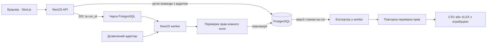

# Архітектура Lead Finder

За рішенням власника від 19.11.2026 головний екран — зовнішній пошук без API та без збереження видачі. Він формує Google/Maps/Instagram search links і не звертається до CRM gateway. Наявна ручна CRM доступна за `/crm`; зв’язку імпорту між екранами немає. [Зовнішній пошук](EXTERNAL_SEARCH.md)

Поточний backend реалізує приватний NestJS API, Prisma migrations, сесії та ручну CRM. Топологія безкоштовного середовища Vercel → Render Free → Neon Free і фактичні маршрути описані в [BACKEND.md](BACKEND.md).

## Гостьовий та захищений доступ

Клієнт ручної CRM за `/crm` завжди починає з гостьового простору. Gateway спрямовує його команди до окремого браузерного сховища, без auth/status та інших API-запитів. За недоступного сховища використовується пам’ять вкладки з попередженням. Для записів між вкладками застосовуються Web Locks та ревізії; помилка запису залишає попередній стан.

Окремими режимами залишаються зашифрована локальна база та серверна CRM після добровільного входу. Перемикання повторно монтує робочий простір, не переносить записи між сховищами та очищає ключ локальної бази. Початковий гостьовий режим не відкриває приватні дані навіть за наявності серверної cookie. CSV формується відповідним gateway. Вихід видаляє браузерну cookie навіть при недоступній БД. Публічна реєстрація заблокована до ізоляції акаунтів. [Межі зберігання](OFFLINE.md) · [Оцінка реєстрації](REGISTRATION_REVIEW.md)

## Поточна послідовність

Власник змінив порядок 18.11.2026. Після каркаса створюється інтерактивний mock frontend, потім реалізується NestJS. Контракт взаємодії та межі прототипу описані в [FRONTEND_CONTRACT.md](FRONTEND_CONTRACT.md).

## Каркас фаз 0–1

| Компонент               | Відповідальність сьогодні                                                              | Межа наступних фаз                                                                 |
| ----------------------- | -------------------------------------------------------------------------------------- | ---------------------------------------------------------------------------------- |
| `apps/web`              | Next.js App Router, українська серверна сторінка на порту 3000                         | Приватний клієнт Nest REST, таблиці, форми, стани. Доступу до БД з браузера немає. |
| `apps/api`              | NestJS HTTP-процес, слухає `PORT` або 3001. Невідомий маршрут повертає 404.            | Сесія, DTO, CRM-команди, читання проєкцій, постановка завдань.                     |
| `apps/worker`           | Окремий Nest application context з коректним завершенням                               | Споживач довговічної PostgreSQL-черги, батчі імпорту, enrichment, експорт.         |
| `packages/db`           | Конфігурація Prisma, PostgreSQL datasource, SQL-проба з’єднання                        | Доменна схема, згенерований клієнт, транзакції, міграції й seed у фазі 2.          |
| `packages/shared`       | Типи походження факту, джерела та операції                                             | DTO, схеми валідації, словники станів.                                             |
| `packages/data-sources` | Централізована політика зберігання та експорту, правила з надійного серверного реєстру | Адаптери нормалізують лише перевірені поля. Всі зовнішні джерела наразі вимкнені.  |

PostgreSQL 17 працює у власному контейнері з іменованим томом. Сервіси каркаса стартують до появи доменних таблиць. Команда `pnpm db:check` окремо виконує `SELECT 1` з Prisma CLI. Пакети збирає pnpm у порядку графа залежностей. Web не отримує конфігурацію Prisma чи облікові дані постачальників.

## Потік даних цільового MVP

API приймає пошук тільки після авторизації. `POST /api/v1/search-runs` повертає 202, Location і run_id. Polling або SSE показує coverage, витрати та помилки окремих джерел. Worker фіксує завершення після commit. Падіння процесу відновлює роботу з останнього checkpoint. Довгі імпорти та експорт живуть поза HTTP-запитом. [Контракти й маршрути, §12](../LEAD_FINDER_TECHNICAL_SPEC_UA.md)

## Володіння даними

| Група майбутніх таблиць (§5)                                                          | Власник запису та інваріант                                                                                                    |
| ------------------------------------------------------------------------------------- | ------------------------------------------------------------------------------------------------------------------------------ |
| users, countries, cities, categories, search_profiles                                 | API та довідники. Профіль фіксує місто, межі, категорію і нормалізований scope.                                                |
| search_runs, source_run_statuses, profile_businesses, source_observations             | Двигун сканів. Окремі результати по джерелу, версії й охопленню.                                                               |
| businesses, brands, business_sources                                                  | Стабільний UUID філії, окрема ідентичність бренду, зв’язок зовнішнього ID з відомою філією. Архівування явне.                  |
| business_facts, business_websites, business_socials, business_contacts, change_events | Версії доказів плюс поточні проєкції. Журнал має run_id і дозволені before/after. Бізнес-контакт має походження.               |
| crm_entries, google_manual_checks, audit_logs                                         | Авторизовані ручні команди. У контракту імпорту немає полів для нотаток, CRM-статусу, follow-up чи opt-out.                    |
| license_registry, exports                                                             | Чинні права, attribution та параметри відтворення файлу. Перед скачуванням перевірити доступ користувача і відкликання джерел. |

У фазі 2 передбачити унікальні обмеження для source ID, run idempotency key, спостереження та membership, індекси за містом/категорією, запуском і часом, нормалізованими іменами, телефонами та доменами. Зв’язок current-факту, lock і зміни оновлювати в одній транзакції. Для історичних вибірок зберігати послідовність commit/версій, включно з ручними змінами. [Рішення про повторний пошук](adr/0002-incremental-sync.md)

## Розгортання і контроль етапів

Next.js SSR та Nest API мають окремі процеси. Worker запускається як background worker. Усі довготривалі дані належать PostgreSQL та, для великих тимчасових файлів, об’єктному сховищу з TTL. Топологія, вартість та майбутні перевірки описані в [плані Render](DEPLOY_RENDER.md).

Доменні міграції належать до фази 2, авторизація і health до фази 3, робочий UI до фази 4, queue engine до фази 5. Перший реальний імпорт у фазі 6 залежить від перевірки конкретного релізу. Критерії готовності та межі MVP наведені у [PRD](PRD.md).
